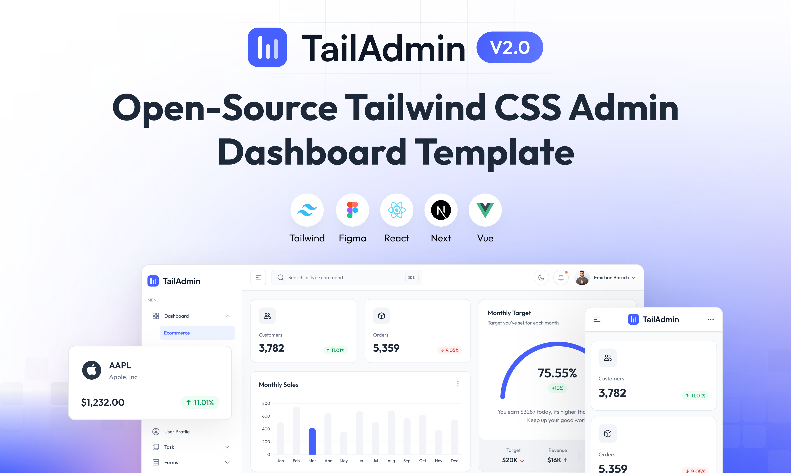

# ADAA Employment LLC - Employment Management Dashboard

ADAA Employment LLC is a professional employment management platform built on **React and Tailwind CSS**, providing comprehensive tools for workforce administration, employee management, and employment services.

This platform offers essential UI components and layouts for building feature-rich, data-driven employment management dashboards and control panels. It's built on:

- React 19
- TypeScript
- Tailwind CSS



## Overview

ADAA Employment LLC provides essential UI components and layouts for building feature-rich, data-driven employment management dashboards and control panels. The platform includes:

- Sophisticated and accessible sidebar navigation
- Employee data visualization components
- Prebuilt profile management and user administration
- Employment data tables and analytics charts
- Authentication forms and input elements
- Alerts, Dropdowns, Modals, Buttons and more
- Dark Mode support 🕶️

All components are built with React and styled using Tailwind CSS for easy customization and professional appearance.

## Features

### Core Functionality

- Employee management and administration
- Employment data tracking and analytics
- User profile management
- Calendar and scheduling tools
- Form elements for data collection
- Data tables for employee information
- Charts and data visualization
- Authentication and user management

### Technical Features

- Modern React 19 with TypeScript
- Responsive design with Tailwind CSS
- Dark/Light mode toggle
- Professional UI components
- Accessible design patterns
- Mobile-friendly interface

## Installation

### Prerequisites

To get started with ADAA Employment LLC, ensure you have the following prerequisites installed and set up:

- Node.js 18.x or later (recommended to use Node.js 20.x or later)

### Setup Instructions

1. Install dependencies:

   ```bash
   npm install
   # or
   yarn install
   ```

   > Use the `--legacy-peer-deps` flag, if you face issues while installing.

2. Start the development server:
   ```bash
   npm run dev
   # or
   yarn dev
   ```

## Usage

This platform is designed for employment agencies, HR departments, and workforce management organizations. It provides:

- **Dashboard**: Overview of employment metrics and key performance indicators
- **Employee Management**: Comprehensive employee data and profile management
- **Calendar**: Scheduling and appointment management
- **Forms**: Data collection and employee information forms
- **Tables**: Employee data display and management
- **Analytics**: Charts and data visualization for employment insights

## License

ADAA Employment LLC platform is proprietary software. All rights reserved.

## Support

For technical support and inquiries about ADAA Employment LLC platform, please contact the development team.
